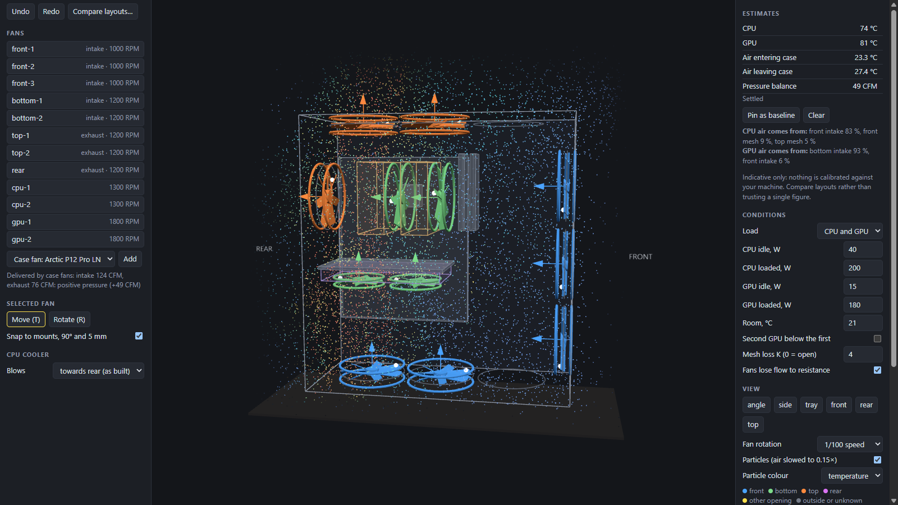
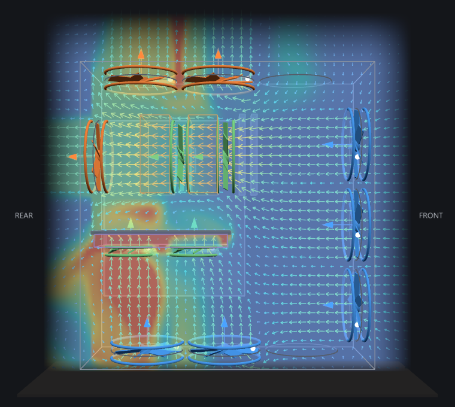

# cooling

[](LICENSE)
[](https://www.typescriptlang.org/)
[](https://www.w3.org/TR/webgpu/)
[](https://threejs.org/)
[](https://vite.dev/)

**See how air moves through an air-cooled PC, in your browser.** Place, turn and re-speed the case, CPU cooler and GPU fans, and watch the flow and indicative temperatures respond. A 3D flow solver runs on your own GPU through WebGPU; there is no back end.



It is a tool for comparing fan layouts and for curiosity about the flow. It is **not** calibrated against real hardware, so read [What the numbers mean](#what-the-numbers-mean) before trusting a figure.

## Features

- Drag, rotate, add and delete fans, with snapping to the case mounts and undo/redo.
- Particles, streamlines, and slices with velocity arrows, coloured by temperature, speed or the intake the air came through.
- Fans that lose flow when they work against resistance.
- Pin a baseline, or run several saved layouts side by side under the same conditions.
- An optional second GPU.



*A vertical slice: temperature as colour, velocity as arrows. The rear of the case is on the left.*

## Running it

Needs Node 22 or later and a current Chrome or Edge.

```sh
git clone https://github.com/JonesRobM/cooling.git
cd cooling
npm install
npm run dev        # then open the printed address
```

`npm test` runs the unit tests and `npm run build` type-checks and builds. The `/diagnostics.html` page checks the solver's mass and heat balance on your GPU.

The default layout, **My PC**, is one real build in an NZXT H7 Flow (2024). Case dimensions and component positions are in `src/model/machine.ts`, and fan data in `src/model/fans.ts`; edit them to model another machine.

## The physics

The air is treated as incompressible, with buoyancy in the Boussinesq approximation (density varies only in the gravity term):

```math
\nabla \cdot \mathbf{u} = 0
```

```math
\frac{\partial \mathbf{u}}{\partial t} + (\mathbf{u} \cdot \nabla)\mathbf{u} = -\frac{1}{\rho}\nabla p + \nu_t \nabla^2 \mathbf{u} + g\beta\,(T - T_0)\,\hat{\mathbf{y}} + \mathbf{f}
```

```math
\frac{\partial T}{\partial t} + \mathbf{u} \cdot \nabla T = \alpha_t \nabla^2 T + \frac{q}{\rho c_p}
```

Here **u** is velocity, *p* pressure, *T* temperature, *T*₀ room temperature, β = 1/*T*₀ (in kelvin), **f** the drag from obstructions and *q* the heat released per unit volume. The eddy viscosity ν<sub>t</sub> and diffusivity α<sub>t</sub> are constants (3×10⁻⁴ m²/s) standing in for turbulence; this is not a turbulence model.

| Part of the PC | How it is modelled |
| --- | --- |
| Fans | Prescribed velocity through the swept disc |
| Heatsinks | Porous blocks with directional drag, releasing the component's power |
| Mesh and vents | Pressure drop Δp = K·½ρv² |
| Tray, glass, solid parts, desk | Closed to flow |
| Room around the case | Open boundary (p = 0), so exhaust can be drawn back in |

**Numerics.** A uniform staggered (MAC) grid of 5 mm cells, about 670 000 of them, with a 4 ms time step. Each step:

1. Advects velocity semi-Lagrangially, then adds viscosity, buoyancy and drag.
2. Solves a pressure Poisson equation with 24 red-black SOR iterations and projects the velocity towards zero divergence.
3. Updates temperature with an upwind finite-volume scheme, implicit on the diagonal.

Temperature takes three updates per flow step to reach a steady state sooner, so transients are not time-accurate. Both advection schemes are numerically diffusive: sharp jets and plumes are smeared.

**Fan operating point.** Free-air flow scales with speed, Q = Q<sub>rated</sub>·RPM/RPM<sub>rated</sub>. Case and CPU fans then lose flow along an assumed curve, Δp = P<sub>max</sub>(1 − (Q/Q<sub>free</sub>)²), according to the pressure the solver finds across them.

**Component temperatures** are not resolved by the grid. A lumped estimate uses the temperature *T*<sub>air</sub> and speed *v* of the air at each heatsink:

```math
T = T_{\text{air}} + P \left( R_{\text{die}} + \frac{k}{v^{0.8}} \right)
```

with power *P* and assumed constants *R*<sub>die</sub> and *k* (`src/model/thermal.ts`).

**Further reading:** Harlow and Welch, [the MAC grid](https://doi.org/10.1063/1.1761178) (1965); Chorin, [the projection method](https://doi.org/10.1090/S0025-5718-1968-0242392-2) (1968); Stam, [*Stable Fluids*](https://doi.org/10.1145/311535.311548) (1999).

## Using it

- Click a fan in the view or the list. Drag its gizmo to move it (**T**) or turn it (**R**).
- With snapping on, case fans dropped near a mount seat themselves, and turns go in 90° steps.
- Set speed, flip, re-aim or delete the selected fan. Add fans from the list below the fan names.
- Fans in the same **speed group** (a motherboard header) share a duty cycle. The default groups are by position; set them to match your wiring.
- CPU fans move between the cooler's three positions; the cooler itself turns in 90° steps.
- **Undo** and **Redo**: buttons, or Ctrl+Z and Ctrl+Y.
- **Second GPU below the first** adds an identical card three expansion slots down (an assumption: measure your board). Both cards carry the GPU load.
- View buttons give angle, side, tray, front, rear and top views. The tray wall is see-through.
- Rotors turn at 1/100 or 1/1000 of real speed, scaled by the flow each fan is delivering.
- The panel lists where the CPU's and GPU's air comes from.
- Wait for **Settled**, pin a baseline, change something, and wait again to see the differences.
- **Compare layouts** keeps named layouts and runs them all under the same conditions (about 15 s each at 5 mm and 45 s at 4 mm on a laptop RTX 4050).
- Layouts persist in the browser and can be saved to or loaded from JSON. **Reset to My PC** restores the default.

## What the numbers mean

Nothing is calibrated against a real machine. Treat results as qualitative.

- The fan pressure curve is assumed. The F120Q's `P_max` comes from a test of a different retail version.
- GPU fans have no curve: there is no pressure data, and a guessed one decided the GPU temperature by itself (over 100 °C). They always deliver full flow, so a card squeezed against another is modelled optimistically. Their 35 CFM is itself a guess.
- The default K = 4 for vented walls is a textbook-style estimate for a half-open perforated plate, not a measurement of this case. How much each fan delivers depends heavily on it, so check conclusions at more than one value.
- The air simulated outside the case extends 80 mm front and rear, 100 mm above, 25 mm below (to the desk) and 50 mm beyond the glass. Nothing is modelled beyond the tray side.
- Between 5 mm and 4 mm grids, CPU estimates moved by up to 1.4 K and kept their ranking; GPU estimates moved by up to 3.8 K and near-ties swapped. Treat CPU differences under about 2 K, and GPU differences under about 3 K, as no difference.
- Case interior dimensions and component positions are estimates.

## Layout of the code

    src/model/   layout, voxelisation, fan curves, tracing, metrics (unit tested)
    src/sim/     WebGPU solver and batch runner
    src/view/    3D scene, fan editing, flow visuals
    src/ui/      side panels and comparison table

Design and plans: [`docs/superpowers/`](docs/superpowers/).

## Licence

[Apache 2.0](LICENSE).
